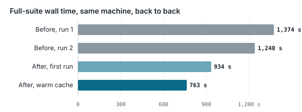

# Keeping tests and worktrees from taking over your machine

*Lessons from making a 7,000-test suite 40% cheaper on a laptop shared by several projects, why a CPU cap was only half the answer, and how to run many worktrees side by side.*



**In this repository**

- This guide.
- [`test-slot`](test-slot): runs a command once one of N machine-wide test slots is free (`TEST_SLOTS`, default 2), so no more than N test runs go at once across all your projects.
- [`wtree`](wtree): one git worktree per task. It links or installs dependencies by lockfile (a workspace repo always installs), gives each worktree a stable port, locks a worktree while something runs in it, removes it safely, and cleans up merged ones.

To use the scripts, copy them onto your `PATH`:

```bash
install -m 755 test-slot wtree ~/.local/bin/
```

Both need bash. `test-slot` needs `flock` (util-linux), and `wtree` needs Linux and Git 2.17 or later. Run `wtree` with no arguments for its usage.

## The situation

One workstation runs several projects at once. Each has a dev server, and each has a test suite that grows every week: more files, heavier setup, slower runs. A full run of one suite used every core for about 20 minutes. The desktop froze, and nothing else could run until it finished.

The first fix was a hard cap of two cores per test run. The machine stayed usable, but the cap was a brake, not a fix:

- The suite cost exactly as much CPU as before. It just took longer.
- On an idle machine, the run still crawled along on two cores.
- Three projects testing at once still took six of the eight threads.

This guide is the whole picture, in the order we would tackle it again:

1. Measure where the time goes.
2. Contain each run so it cannot hurt anything else.
3. Run less.
4. Make each run cheaper.
5. Give each task a worktree that is cheap to create and safe to remove.
6. Measure every change honestly.

The examples use Node and Vitest on Linux, but every idea has an equivalent in other stacks.

## 1. Measure before you change anything

Record three numbers for every run: **wall time, CPU time and peak memory**. On Linux, run the suite in a transient systemd scope, and the kernel does the accounting for you:

```bash
systemd-run --user --scope -p MemoryMax=4G -- npx vitest run
journalctl --user | grep Consumed     # "run-….scope: Consumed 24min 39s CPU time"
```

Then split the CPU time into **loading code** and **running tests**. Vitest's summary line separates `import` from `tests`, and Vitest 4 can list the slowest imports (`test.experimental.importDurations` in the config). For any Node runner, `node --cpu-prof` on a single worker shows whether the time goes to module loading or to your own code.

What we found:

- In one service's 44 test files, **importing took 102–126 s of worker time, and the tests themselves only 24–28 s**. Roughly 80% of the cost was loading code, again and again.
- The reason is the runner's per-file isolation. Each test file gets a fresh module registry, so every file re-imports its whole dependency graph.
- Memory was not the problem: 0.3–0.8 GB per worker.
- The import profile named the heaviest chains, and they were our own code, not a third-party package:
  - Importing one service pulled in nearly every other service, through a single document builder.
  - A test helper loaded a database-migration library, at about 4 s per file, even when every test in the file was skipped.

## 2. Contain the run: priority, not just a ceiling

Three things freeze a desktop:

- **Memory.** Once RAM is full, the kernel starts swapping and everything stalls. This is usually the real freeze.
- **CPU contention** that the test run wins against your editor and browser.
- **Disk I/O.**

The usual knobs don't all do what they promise:

| Knob | What it does | The catch |
|---|---|---|
| `nice` | Lowers priority among processes in the same group | Modern desktops group processes (cgroups, autogroup), and niceness does not count across groups. In our test, a `nice 19` busy loop in its own systemd scope still took **60%** of a shared core from a normal-priority process. |
| CPU quota (`CPUQuota=200%`, Docker `--cpus`) | A hard ceiling | Wastes idle cores, so the run is just as slow at 3 a.m. It does nothing to coordinate projects. |
| **CPU weight** (`CPUWeight=`, Docker `--cpu-shares`) | A relative share when cores are contested. Otherwise the run uses every idle core. | Only matters under contention, which is the point. In the same test, weight 10 took **14–17%** of the shared core. |
| **Memory cap, no swap** (`MemoryMax=`, `MemorySwapMax=0`) | Kills the run instead of letting the machine swap | Size it from the measured peak. A killed run is a clear failure, not a frozen desktop. |
| I/O weight (`IOWeight=`, `ionice -c3`) | Disk priority | Matters for database-heavy suites. |

A wrapper that uses them together:

```bash
systemd-run --user --scope --quiet \
  -p MemoryMax=6G -p MemorySwapMax=0 \
  -p CPUWeight=20 -p IOWeight=20 \
  -p CPUQuota=600% \
  -- npx vitest run
```

`CPUQuota=600%` is optional. On an 8-thread laptop it keeps two threads free, for heat and for headroom. The weight does the real work: tests get every idle core and step aside as soon as you need the machine. Give dev servers the normal weight; they are interactive.

**Size workers by memory, not by cores.** Each worker is a full Node process with its own copy of the loaded code, so workers × peak memory per worker, plus the main process, must stay under the memory cap.

**Several projects at once need a machine-wide limit** on how many test runs go at a time. A dozen lines of `flock` is enough ([`test-slot`](test-slot) in this repository):

```bash
#!/usr/bin/env bash
# test-slot: run a command once one of N machine-wide test slots is free.
# Usage: test-slot <command...>   (TEST_SLOTS=2 by default)
slots=${TEST_SLOTS:-2}
dir=${XDG_RUNTIME_DIR:-/tmp}/test-slots
mkdir -p "$dir"
while :; do
  for i in $(seq 1 "$slots"); do
    exec 9>"$dir/$i.lock"
    if flock -n 9; then exec "$@"; fi
  done
  sleep 2
done
```

Every project's test script starts with `test-slot …`. The lock is held for the life of the command, and a run that dies releases it automatically.

**Tests that assert timing fail on a busy machine.** Performance budgets and short timeouts around subprocesses were the only failures left in our suite after all the changes, on the old code and the new alike. Move them into their own group that runs alone, or assert ratios instead of seconds.

## 3. Run less

- **Locally, run only the tests affected by your change**: `vitest --changed origin/main`, `jest --changedSince=origin/main`, `pytest-testmon`, or Go's built-in test cache.
  - Files the import graph cannot see also need to trigger a full run: the lockfile, `tsconfig`, and any file your test config reads.
  - In Vitest these "force rerun" patterns are matched against absolute paths. Write `**/path/to/file`. A bare relative path silently never matches; we shipped that bug and caught it in review.
- **The full suite is the merge gate, not the inner loop.** Run it in CI, on a self-hosted runner on another machine, or overnight. When you do run it all, shard it (`--shard=1/3`).
- **Give slow kinds of test their own group**: real databases, performance and end-to-end. Then the default run stays fast.

## 4. Make each run cheaper

### Isolation is the hidden cost

Per-file isolation is the safe default, because one file's mocks and global state cannot leak into the next. The price is re-importing the whole graph for every file. Turning isolation off everywhere made a sample run twice as fast, and broke 4–8 of its 44 files through leaked mocks and leaked module state.

What worked was sharing loaded code **only between files proven safe**:

1. **A classifier** flags every file that uses a pattern that can leak: module mocks, environment or global stubs, spies, fake timers, module resets, and direct writes to `process.env` or `globalThis`. It reads the source text, comments included, so it errs toward isolation.
2. **A census** runs the remaining files with isolation off, twice: once in normal order and once shuffled, because leaks depend on order. One more run with isolation on is the control, so that "fails when shared" can be told apart from "fails anyway". Only files that pass every run join.
3. **An explicit list**, read by the test config, rechecked on every load:
   - A listed file that starts mocking drops back to isolation by itself.
   - A test fails as soon as the list goes stale, for example when a listed file is deleted.
4. **New test files stay isolated** until someone adds them to the list. That is slow by default, but never wrong by default.

In Vitest this is two `projects`: the default one isolated, and one with `isolate: false` whose `include` is the list. In our suite, 350 of 675 files share. On its own, sharing measured **28% faster** for the full suite. Runners differ here: pytest shares imports within a worker by default, while Jest always isolates per file, so with Jest the import cuts below matter most.

### Cut the import graph

- **Load heavy modules lazily**, only on the path that needs them (`await import()`). Our migration library went from about 4 s per file to 0.1–0.2 s.
- **Watch for eager globs and barrel files.** In Vite, `import.meta.glob(…, { eager: true })` compiles into top-level imports, and an `index.ts` that re-exports everything makes one import load the lot.
- **Watch for modules that wire up each other at load time.** When services import each other's singletons at the top of the file, importing one loads them all. Inject the dependency or import it lazily.

### Caches: measure each one

| Tried | Result |
|---|---|
| Vitest's on-disk module cache (`experimental.fsModuleCache`) | 8–19% less CPU on later runs. Kept, for local runs only. |
| Node's compile cache (`NODE_COMPILE_CACHE`) | No measurable gain |
| The `vmThreads` pool | Ran out of memory at a 4 GB cap |
| The `threads` pool instead of `forks` | No gain (84 s vs 85 s) |
| Running tests on the GPU | Not applicable. JavaScript runs on the CPU, and GPU libraries only speed up their own calls. |

### Databases

Share one database container between all your checkouts, and never let one project tear it down. General techniques worth knowing, though we did not use them here: Postgres can clone a prepared database quickly with `CREATE DATABASE … TEMPLATE`, and a test-only database can keep its data on `tmpfs` with `fsync=off`.

## 5. Worktrees: one per task, cheap to create, safe to remove

Parallel work wants one checkout per task: several branches in flight, several people, or several AI agent sessions at once. `git worktree` gives each task its own directory and branch on top of one shared object store, so a single `git fetch` serves them all. The checkout itself is cheap. What costs disk and causes mistakes is everything around it: dependencies, env files, ports, databases, caches, and the processes still running inside it.

### What we ran

Four small scripts and a naming rule:

- `new <branch>` made a sibling directory, a hard-link copy of the main checkout's `node_modules` (`cp -al`), and a symlink to each `.env*` file in the main checkout.
- `dev` started the dev server on the first free port above a fixed base. If `node_modules` was a symlink, it swapped it for a hard-link copy first, because the bundler (Turbopack) refuses a symlinked `node_modules`.
- `rm <branch>` deleted `node_modules` and the env links, ran `git worktree remove --force`, and offered to delete the branch.
- `ls` listed the worktrees.
- By convention, the lead made one worktree per parent task and the developer made one per subtask from it, all named by issue number inside one `<repo>-wt/` folder.

It carried dozens of tasks and several agent sessions at once. It also went wrong in ways worth avoiding:

- **The disk filled up: 168 worktrees, 14 GB.** A hard-link copy costs about 20 MB when it is made. The next time the main checkout reinstalls, the copy keeps the old files and becomes a private copy of about 1.1 GB.
- **The scripts and the convention drifted apart.** `new` and `rm` built one path layout, and the convention used another, so most worktrees were made and removed by hand. Some ended up with a symlink and some with a copy.
- **Removal could destroy work.** `--force` skips git's own check for uncommitted work. Nothing checked whether a dev server or an agent session was still running inside.
- **The port changed between restarts,** because it was whichever port was free at the time.

Removing 96 worktrees of merged work took the folder from 14 GB to under 5 GB.

### What we would do now

**Keep worktrees outside the repository**, in a sibling folder such as `~/code/app-wt/<name>`, and name each worktree and its branch after the task. Tools scan nested directories by default: TypeScript's `include` is `**/*`, and [Vitest](https://vitest.dev/config/exclude) and [ESLint](https://eslint.org/docs/latest/use/configure/ignore) exclude only `node_modules` and `.git`. A worktree inside the repository is type-checked, tested and linted again from every other checkout. Claude Code's `--worktree` puts worktrees in `.claude/worktrees/` inside the repository; a `WorktreeCreate` hook can create them elsewhere ([docs](https://code.claude.com/docs/en/worktrees)).

**Decide dependencies by lockfile, and check again every time the worktree is used.**

| Situation | Do |
|---|---|
| The worktree's lockfile is identical to the main checkout's, in a single-package repository | Symlink `node_modules` to the main checkout's. It costs nothing. |
| The lockfile differs (the branch adds or upgrades a package) | Install inside the worktree. With npm that is a full copy, deleted with the worktree. |
| The repository is a workspace (`packages:` in `pnpm-workspace.yaml`, or `workspaces` in `package.json`) | Always install inside the worktree, even when the lockfiles match. The package manager links workspace packages with relative symlinks (`node_modules/@app/db -> ../../packages/db`), so through a linked `node_modules` they resolve into the main checkout's sources, and each package's own `node_modules` is not covered. We reproduced it: through the link, the worktree loaded the main checkout's package. |
| A bundler refuses a symlinked `node_modules` | Next.js 16.4 added `experimental.turbopackAdditionalRoots`, which follows symlinks outside the project ([docs](https://nextjs.org/docs/app/api-reference/config/next-config-js/turbopack)). On older versions, make a copy just before the build and remove it afterwards. |

- **Check at every use, not only at creation.** The main checkout moves on. A linked worktree then silently runs newer packages than its own branch declares.
- **Never run `npm install` through a symlinked `node_modules`.** It rewrites the main checkout's packages.
- **A hard-link copy is not independent.** We tested it: appending to a file in the copy changed the main checkout's file. Tools that write a new file and rename it over the old one (`sed -i`, package managers) only break the link, which is how the copy grows into a full one. A copy-on-write copy (`cp --reflink`) is independent and starts free, but it needs Btrfs, XFS or APFS. ext4 has no such copy.
- **For Node, the lasting fix is a content-addressed store.** pnpm's `virtualStoreType: global` (called `enableGlobalVirtualStore` before v11.23) gives each worktree "a nearly free `node_modules`" ([pnpm](https://pnpm.io/git-worktrees)). The store must sit on the same filesystem, and pnpm warns against sharing one writable store between users or agents that don't trust each other. npm has no store. Changing package manager is a decision for the project, not for this guide.

> **The trailing-slash trap.** In a worktree whose `node_modules` is a symlink, `rm -rf node_modules` removes the link. `rm -rf node_modules/`, which is what tab completion types, empties the main checkout's `node_modules` and exits 0. We reproduced it. Remove worktrees with `git worktree remove`: it unlinks a symlink without following it.

**Copy ignored files from a list.** Put the gitignored files a new worktree needs (`.env`, `.env.local`) in a `.worktreeinclude` file at the repository root, in gitignore syntax. Claude Code and [Conductor](https://www.conductor.build/docs/reference/worktreeinclude) both read it. Copy shared settings, and keep per-worktree values such as the port and database name in a file the setup writes. Next.js reads `PORT` from the environment but not from `.env` ([docs](https://nextjs.org/docs/app/api-reference/cli/next)), so the wrapper sets it.

**Derive the port from the name.** Map the issue number or a hash of the name into a fixed range, for example 3100 + (n mod 900). The port then survives restarts, so bookmarks, cookies and OAuth callback URLs keep working, and two servers starting at once cannot grab the same "first free" port. If a worktree runs several servers, give it a block of ports; Conductor gives each workspace ten ([docs](https://www.conductor.build/docs/core/scripts)).

**Share one database server, and give a worktree its own database only when its branch changes the schema.** `CREATE DATABASE app_1432 TEMPLATE app_seed` copies a prepared database, as long as nothing is connected to the template at the time ([Postgres](https://www.postgresql.org/docs/current/manage-ag-templatedbs.html)). Drop it when the worktree goes. Docker Compose names a project after its directory ([Docker](https://docs.docker.com/compose/how-tos/project-name/)), so set `COMPOSE_PROJECT_NAME` from the worktree name if each worktree needs its own stack.

**Keep caches and build output inside the worktree,** so they go with it. Next.js 16 writes `next dev` output to `.next/dev`, including a `.next/dev/lock` file with the server's PID, port and URL ([docs](https://nextjs.org/docs/app/guides/ai-agents)). That file tells you, or an agent, that a server is already running and where.

**Mark a worktree in use.** Run `git worktree lock --reason "dev server pid 12345"` while something runs in it; `git worktree remove` refuses a locked worktree. A lock whose PID has exited is stale and can be lifted.

**Remove only what is safe to remove.** Refuse when the worktree:

- has uncommitted or untracked work. Plain `git worktree remove` already refuses, so never pass `--force` by default. It still deletes ignored files such as `node_modules` and `.env`, which is what you want;
- is locked by a running process;
- has any process whose working directory is inside it. A scan of `/proc/*/cwd` takes about a second on Linux.

Then delete the branch only if it is merged. `git branch --merged` misses squash merges. After `git fetch --prune`, a branch whose upstream shows `[gone]` was deleted on the server, usually because it was merged ([more](https://adamj.eu/tech/2022/10/30/git-how-to-clean-up-squash-merged-branches/)).

**Clean up on a schedule.** A worktree can go when it is clean, unlocked and idle, and its branch is merged or its upstream is gone. List those with their size, then remove them. [Cursor](https://cursor.com/docs/configuration/worktrees) caps its worktrees at 25 instead.

**AI agents in worktrees:**

- Give agents absolute paths. An agent working in a nested worktree once wrote its edits into the main checkout through a relative path.
- Check which commit a tool starts from. Claude Code starts agent worktrees from the default branch unless `worktree.baseRef` is `head`. Our agents once started behind the branch they were meant to extend.
- One writer per worktree. The coordinating session owns git: agents edit files, and the coordinator commits, merges and removes.
- Cap how many worktrees run at once across the machine, as with test runs.

**Git features worth knowing** ([manual](https://git-scm.com/docs/git-worktree)):

| Command | What it gives you | Since Git |
|---|---|---|
| `git worktree lock` / `unlock` | An in-use marker that `remove` respects | 2.10 |
| `git worktree move` / `remove` | Safe move and removal | 2.17 |
| `extensions.worktreeConfig`, `git config --worktree` | Settings for one worktree only | 2.20 |
| `git worktree repair` | Fixes links after folders were moved by hand | 2.29 |
| Relative worktree links (`worktree.useRelativePaths`) | A worktree folder that can move or be mounted in a container | 2.48 |
| `git worktree list --porcelain` | Machine-readable list, including `locked` and `prunable` | — |
| `git worktree prune` | Forgets worktrees whose folders were deleted by hand | — |

A branch can be checked out in only one worktree at a time.

**Or use a tool.** These do the above from a config file:

| Tool | Adds |
|---|---|
| [worktrunk](https://github.com/max-sixty/worktrunk) | Lifecycle hooks, a port per worktree, copies ignored files with reflinks, merge-and-clean-up in one step |
| [git-worktree-runner](https://github.com/coderabbitai/git-worktree-runner) | Copy patterns, setup hooks that run only after you trust them, removal of worktrees whose PR merged |
| [wtp](https://github.com/satococoa/wtp) | Copy, symlink and command steps on create; removes the branch with the worktree |
| [Conductor](https://www.conductor.build/docs/core/scripts) | Setup, run and archive scripts per workspace, and ten ports each |
| [Claude Code `--worktree`](https://code.claude.com/docs/en/worktrees) | Reads `.worktreeinclude`, locks while an agent runs, removes clean worktrees, `WorktreeCreate`/`WorktreeRemove` hooks |

**A reference script.** [`wtree`](wtree), about 240 lines of bash in this repository, applies these rules to an npm, pnpm, Yarn or Bun project:

```text
wtree new <name> [base]    sibling worktree + branch, copy .worktreeinclude files, deps
wtree deps [name]          link node_modules if the lockfile matches the main checkout, else install;
                           a workspace repo always installs
wtree port [name]          the worktree's stable port
wtree run [name] -- cmd    re-check deps, run cmd with PORT set, locked while it runs
wtree rm <name>            refuse if dirty, locked or busy; never --force; delete the branch only if merged
wtree gc [--apply]         list (or remove) merged or upstream-gone worktrees with their size
```

Every path in it was exercised against a scratch repository: linking and installing, installing in pnpm and npm workspaces, the lock, refusing dirty, locked and busy worktrees, lifting a stale lock, and squash-merge detection. It reads `.worktreeinclude` as plain globs from the repository root, not full gitignore syntax, so negations such as `!.env.example` are not supported.

## 6. Measure every change honestly

- **Shared machines are noisy.** The same suite used 2,009 s of CPU at a quiet hour, and 2,381–2,576 s while other projects were testing: a 20–28% swing with no code change.
- **Compare back to back, with the old version first and last** (A, B, A). Report the scope's CPU time next to wall time.
- **Small samples lie.** On a 44-file sample, the module cache looked like anything from 8% worse to 19% better. Only the full-suite comparison settled it.

Our result: the full suite went from about 1,307 s to **763 s**, which is **42% less wall time and 40% less CPU**, with no test skipped or loosened. The first run in a fresh checkout, before the module cache fills, was 28% faster.

## So, was the two-core cap wrong?

It was the right emergency brake and the wrong long-term tool. A ceiling keeps the machine usable, but it keeps tests slow when the machine is idle, and it doesn't stop three projects from each taking their share. A **low CPU weight** gives you both: tests use every idle core and yield as soon as you need the machine. Keep the hard limit for **memory**, which is what actually freezes a desktop. Add a loose CPU ceiling only if heat on a laptop is a concern. Then cut the work itself: run less, share what is safe to share, and load less code.

## Checklist

- [ ] Measure wall time, CPU time, peak memory, and import time against test time.
- [ ] Run tests in a scope with a memory cap (no swap) and a low CPU and I/O weight.
- [ ] Size workers by memory.
- [ ] Limit concurrent test runs across the whole machine.
- [ ] Locally, run affected tests by default. Run the full suite as the merge gate, elsewhere if you can.
- [ ] Give timing-sensitive tests their own group.
- [ ] Isolate only where needed: a classifier, a census, and a list that rechecks itself.
- [ ] Load heavy modules lazily. No eager globs or catch-all barrels.
- [ ] Measure every cache before adopting it.
- [ ] Keep worktrees in a sibling folder, named after the task.
- [ ] Link `node_modules` when the lockfile matches the main checkout's, install when it doesn't, and check again on every use.
- [ ] Copy ignored files from a `.worktreeinclude` list, and derive each worktree's port from its name.
- [ ] Lock a worktree while something runs in it. Remove only clean, unlocked, idle ones, without `--force`.
- [ ] Remove worktrees of merged work on a schedule, and cap how many run at once.

---

Text licensed under [CC BY 4.0](https://creativecommons.org/licenses/by/4.0/). Scripts licensed under MIT (see [`LICENSE`](LICENSE)).
